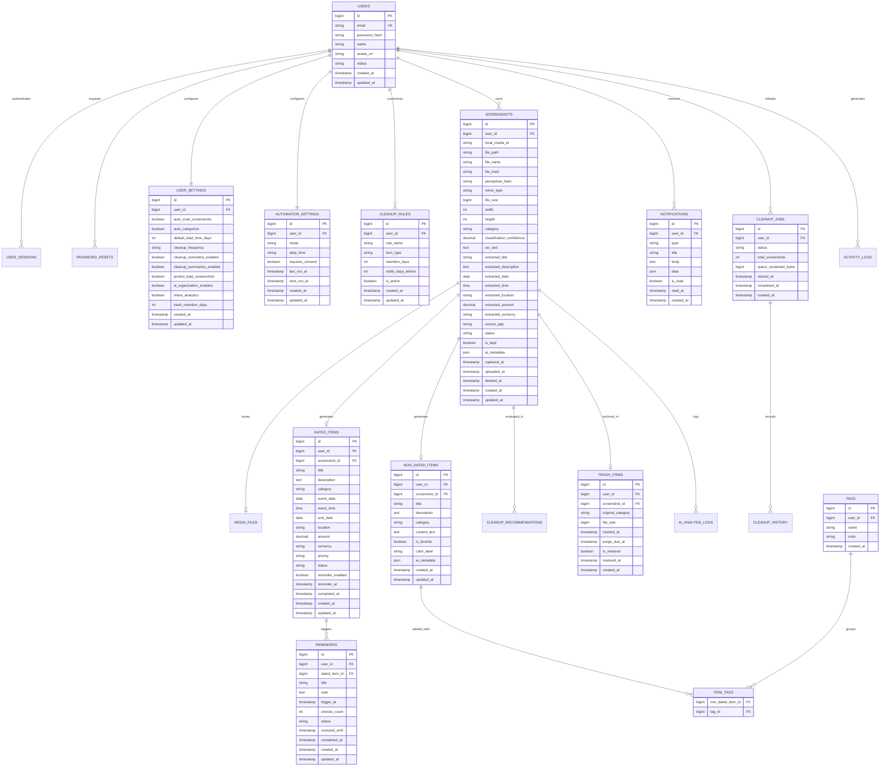

# SnapTask — Implementation Plan

This implementation plan details the architecture, file catalog, database entity-relationship model, API endpoints, and rollout strategy for the **SnapTask** backend and AI layer.

---

## 1. File Catalog

Every file to be created is cataloged below across the three primary workspaces.

### 1.1 `snaptask-backend/` (PHP 8.2+ REST API)
```text
snaptask-backend/
├── app/
│   ├── Config/
│   │   ├── App.php                     # App environment, base URL, debug settings
│   │   ├── Database.php                # PDO connection parameters & options
│   │   └── AiService.php               # AI microservice endpoint & API key
│   ├── Core/
│   │   ├── Router.php                  # REST router with route params & middleware chaining
│   │   ├── Request.php                 # HTTP request encapsulation (headers, body, files, params)
│   │   ├── Response.php                # Unified JSON response builder with standard envelopes
│   │   ├── Database.php                # PDO singleton connection manager with transaction support
│   │   ├── Jwt.php                     # Pure PHP HMAC-SHA256 JWT encoder/decoder
│   │   ├── Logger.php                  # Monolog-style structured file logger
│   │   └── ErrorHandler.php            # Global exception/error handler returning standardized JSON
│   ├── Middleware/
│   │   ├── CorsMiddleware.php          # CORS headers & preflight OPTIONS handler
│   │   ├── AuthMiddleware.php          # Bearer JWT verification & user injection
│   │   └── RateLimitMiddleware.php     # In-memory / file-based sliding window rate limiter
│   ├── Models/
│   │   ├── User.php                    # User entity model
│   │   ├── Screenshot.php              # Screenshot metadata & OCR entity
│   │   ├── DatedItem.php               # Dated screenshot item entity
│   │   ├── NonDatedItem.php            # Non-dated screenshot item entity
│   │   ├── Reminder.php                # Reminder scheduling entity
│   │   ├── Notification.php            # User notification entity
│   │   ├── CleanupJob.php              # Cleanup batch job entity
│   │   ├── TrashItem.php               # 30-day trash recovery entity
│   │   ├── UserSettings.php            # App-level user settings entity
│   │   └── CleanupRule.php             # Configurable retention rules entity
│   ├── Repositories/
│   │   ├── UserRepository.php          # User & session database queries
│   │   ├── ScreenshotRepository.php    # Screenshot CRUD, search & stats queries
│   │   ├── DatedItemRepository.php     # Dated items queries & filters
│   │   ├── NonDatedItemRepository.php  # Non-dated items & tags queries
│   │   ├── ReminderRepository.php      # Reminder filters & trigger queries
│   │   ├── NotificationRepository.php  # Notification inbox & unread counters
│   │   ├── CleanupRepository.php       # Cleanup eligibility & batch execution
│   │   ├── TrashRepository.php         # Trash recovery & permanent purge queries
│   │   ├── DashboardRepository.php     # Aggregated stats & chart queries
│   │   └── SettingsRepository.php      # Settings, automation & rules persistence
│   ├── Services/
│   │   ├── AuthService.php             # Registration, login, token refresh, password reset
│   │   ├── ScreenshotService.php       # Upload handling, hash generation, pipeline trigger
│   │   ├── DatedItemService.php        # Business logic for dated items & reminders
│   │   ├── NonDatedItemService.php     # Business logic for non-dated items & tags
│   │   ├── ReminderService.php         # Reminder state management (snooze, complete)
│   │   ├── NotificationService.php     # Notification dispatching & read state
│   │   ├── CleanupService.php          # Retention evaluation, space calculation, job creation
│   │   ├── TrashService.php            # 30-day recovery management & restore actions
│   │   ├── DashboardService.php        # Metric aggregations for Home Dashboard
│   │   ├── SettingsService.php         # Preferences, rules & privacy management
│   │   └── AiServiceClient.php         # cURL client calling Python FastAPI microservice
│   ├── Controllers/
│   │   ├── AuthController.php          # /api/v1/auth/* handlers
│   │   ├── ScreenshotController.php    # /api/v1/screenshots/* handlers
│   │   ├── DatedItemController.php     # /api/v1/dated-items/* handlers
│   │   ├── NonDatedItemController.php  # /api/v1/non-dated-items/* handlers
│   │   ├── ReminderController.php      # /api/v1/reminders/* handlers
│   │   ├── NotificationController.php  # /api/v1/notifications/* handlers
│   │   ├── CleanupController.php       # /api/v1/cleanup/* handlers
│   │   ├── TrashController.php         # /api/v1/trash/* handlers
│   │   ├── DashboardController.php     # /api/v1/dashboard/* handlers
│   │   ├── SettingsController.php      # /api/v1/settings/* handlers
│   │   └── AiProxyController.php       # /api/v1/ai/* handlers
│   ├── Validators/
│   │   ├── AuthValidator.php           # Registration & login validation rules
│   │   ├── ScreenshotValidator.php     # Upload & filter validation rules
│   │   ├── DatedItemValidator.php      # Dated item input validation
│   │   ├── NonDatedItemValidator.php   # Non-dated item input validation
│   │   ├── ReminderValidator.php       # Reminder input validation
│   │   ├── SettingsValidator.php       # Settings & rules input validation
│   │   └── CleanupValidator.php        # Cleanup review & confirmation validation
│   └── Helpers/
│       ├── Validator.php               # Generic validation rules engine
│       ├── FileUpload.php              # MIME validation, safe naming, storage helper
│       └── HashHelper.php              # SHA256 & difference hash helper
├── database/
│   ├── schema.sql                      # Complete normalized MySQL 8 schema DDL
│   ├── install.php                     # CLI migration & seeder runner script
│   ├── migrations/
│   │   ├── 001_create_users_and_auth_tables.sql
│   │   ├── 002_create_settings_and_rules_tables.sql
│   │   ├── 003_create_screenshots_and_media_tables.sql
│   │   ├── 004_create_items_and_tags_tables.sql
│   │   ├── 005_create_reminders_and_notifications_tables.sql
│   │   ├── 006_create_cleanup_and_trash_tables.sql
│   │   └── 007_create_logs_tables.sql
│   └── seeders/
│       ├── 001_demo_user_and_settings_seeder.sql
│       └── 002_sample_data_seeder.sql
├── public/
│   └── index.php                       # Single entry point for all API requests
├── routes/
│   └── api.php                         # Route definitions mapping to controllers
├── storage/
│   ├── uploads/                        # Uploaded screenshot files (with .gitkeep)
│   └── logs/                           # Application and error logs (with .gitkeep)
├── tests/
│   ├── Unit/
│   │   ├── ValidatorTest.php           # Tests for input validation engine
│   │   └── AuthServiceTest.php         # Tests for auth service logic & JWT
│   └── Integration/
│       ├── AuthApiTest.php             # Integration tests for auth endpoints
│       └── ScreenshotUploadTest.php    # Integration tests for upload & classification
├── .env.example                        # Template for environment variables
├── composer.json                       # PHP dependencies & PSR-4 autoloading
├── README.md                           # Setup, installation & execution guide
└── postman/
    ├── SnapTask.postman_collection.json # Complete API collection with tests
    └── SnapTask.postman_environment.json# Local dev environment configuration
```

---

### 1.2 `snaptask-ai/` (Python FastAPI AI Microservice)
```text
snaptask-ai/
├── main.py                             # FastAPI application factory & Uvicorn runner
├── app/
│   ├── api/
│   │   └── routes_ai.py                # REST endpoints for OCR, dates, classification & cleanup
│   ├── core/
│   │   ├── config.py                   # Pydantic Settings, environment variables
│   │   └── security.py                 # API Key authentication header verification
│   ├── models/
│   │   └── schemas.py                  # Pydantic request & response DTO schemas
│   ├── services/
│   │   ├── image_service.py            # Image preprocessing, RGB conversion, perceptual hashing
│   │   ├── ocr_service.py              # Tesseract OCR engine with fallback handling
│   │   ├── classification_service.py   # Hybrid rule + keyword + heuristic classifier
│   │   ├── date_extraction_service.py  # Regex + dateparser extraction for events & deadlines
│   │   ├── task_extraction_service.py  # Entity & intent extraction (title, cost, venue, actions)
│   │   └── cleanup_service.py          # Eligibility rules, duplication check & risk evaluation
│   └── utils/
│       └── text_utils.py               # Text cleaning, normalization, currency parsing
├── tests/
│   ├── test_ocr.py                     # OCR text cleaning & preprocessing tests
│   ├── test_date_extraction.py         # Date & time parsing unit tests
│   ├── test_classification.py          # Category assignment & confidence tests
│   └── test_cleanup.py                 # Cleanup recommendation & risk score tests
├── samples/
│   ├── sample_ticket.png               # Test screenshot asset: Jazz concert ticket
│   └── sample_recipe.png               # Test screenshot asset: Pasta recipe
├── requirements.txt                    # Python dependencies
├── .env.example                        # AI service environment configuration template
└── README.md                           # AI service setup, testing & execution guide
```

---

### 1.3 `android-integration/` (Architecture & Integration Contracts)
```text
android-integration/
├── MVVM_ARCHITECTURE.md                # Layered Clean MVVM architecture guide with Compose
├── API_CONTRACTS.md                    # Exact REST request/response schemas & error codes
├── DATA_MODELS.md                      # Kotlin data classes, Room entities, and Domain models
└── REPOSITORY_EXAMPLES.md              # Complete Kotlin code for Repositories, ViewModels & Workers
```

---

## 2. Database Schema ERD (Mermaid Syntax)



---

## 3. Comprehensive API Endpoint Table

| HTTP Method | Route | Auth | Request Parameters / Body | Response Payload Summary | Matching Android Screen |
|:---|:---|:---:|:---|:---|:---|
| **POST** | `/api/v1/auth/register` | No | `{ name, email, password }` | `{ user, access_token, refresh_token }` | Onboarding / Auth |
| **POST** | `/api/v1/auth/login` | No | `{ email, password, device_name }` | `{ user, access_token, refresh_token }` | Welcome / Auth |
| **POST** | `/api/v1/auth/refresh` | No | `{ refresh_token }` | `{ access_token, refresh_token }` | Session background refresh |
| **POST** | `/api/v1/auth/logout` | Yes | `{}` | `{ message: "Logged out" }` | Settings |
| **GET** | `/api/v1/auth/me` | Yes | — | `{ user, settings }` | App start / Welcome |
| **PUT** | `/api/v1/auth/profile` | Yes | `{ name, avatar_url }` | `{ user }` | Settings |
| **PUT** | `/api/v1/auth/change-password` | Yes | `{ current_password, new_password }` | `{ message: "Password updated" }` | Settings |
| **GET** | `/api/v1/settings` | Yes | — | Complete settings object | `SettingsScreen` |
| **PUT** | `/api/v1/settings` | Yes | `{ cleanup_reminders, cleanup_summaries }` | Updated settings object | `SettingsScreen` |
| **GET** | `/api/v1/settings/automation` | Yes | — | Automation mode, daily time, consent | `AutomationSettingsScreen` |
| **PUT** | `/api/v1/settings/automation` | Yes | `{ mode: "daily"\|"manual", daily_time }` | Updated automation preferences | `AutomationSettingsScreen` |
| **GET** | `/api/v1/settings/cleanup-rules` | Yes | — | Array of retention rules | `CleanupRulesScreen` |
| **POST** | `/api/v1/settings/cleanup-rules` | Yes | `{ item_type, retention_days, notify_days }` | Created rule object | `CleanupRulesScreen` |
| **PUT** | `/api/v1/settings/cleanup-rules/{id}` | Yes | `{ retention_days, notify_days, is_active }` | Updated rule object | `CleanupRulesScreen` |
| **DELETE** | `/api/v1/settings/cleanup-rules/{id}` | Yes | — | Deletion confirmation | `CleanupRulesScreen` |
| **GET** | `/api/v1/settings/privacy` | Yes | — | AI organization & analytics consent | `PermissionsPrivacyScreen` |
| **PUT** | `/api/v1/settings/privacy` | Yes | `{ ai_organization, share_analytics }` | Updated privacy flags | `PermissionsPrivacyScreen` |
| **POST** | `/api/v1/screenshots/upload` | Yes | Multipart: `file`, `local_media_id`, `captured_at` | Screenshot record & initial status | `ScreenshotScanningScreen` |
| **GET** | `/api/v1/screenshots` | Yes | `?category=&status=&page=&limit=` | Paginated screenshot list | Library screens |
| **GET** | `/api/v1/screenshots/{id}` | Yes | — | Full screenshot & classification entity | Detail screens |
| **PUT** | `/api/v1/screenshots/{id}` | Yes | `{ is_kept, category, extracted_title }` | Updated screenshot record | Detail screens |
| **DELETE** | `/api/v1/screenshots/{id}` | Yes | — | Move to trash confirmation | Detail / Cleanup screens |
| **POST** | `/api/v1/screenshots/{id}/analyze` | Yes | — | Trigger OCR & AI classification | `ScreenshotScanningScreen` |
| **POST** | `/api/v1/screenshots/bulk-analyze` | Yes | `{ screenshot_ids: [...] }` | Batch analysis progress & summary | `ScreenshotScanningScreen` |
| **GET** | `/api/v1/screenshots/search` | Yes | `?query=jazz&from_date=&to_date=` | Search results list | Home & Library search fields |
| **GET** | `/api/v1/screenshots/stats` | Yes | — | Counts by category, total size (MB) | `HomeDashboardScreen` |
| **GET** | `/api/v1/dated-items` | Yes | `?category=&status=&sort=date_asc` | List of dated screenshots & metadata | `DatedScreenshotsScreen` |
| **GET** | `/api/v1/dated-items/{id}` | Yes | — | Full dated item detail | `DatedDetailScreen` |
| **POST** | `/api/v1/dated-items` | Yes | `{ screenshot_id, title, event_date, ... }` | Created dated item | Manual add / AI create |
| **PUT** | `/api/v1/dated-items/{id}` | Yes | Editable fields (title, date, priority) | Updated dated item | `DatedDetailScreen` |
| **DELETE** | `/api/v1/dated-items/{id}` | Yes | — | Deletion confirmation | `DatedDetailScreen` |
| **GET** | `/api/v1/dated-items/overdue` | Yes | — | Overdue items list | `RemindersScreen` |
| **GET** | `/api/v1/dated-items/this-week` | Yes | — | Items occurring this week | `DatedScreenshotsScreen` |
| **GET** | `/api/v1/dated-items/upcoming` | Yes | — | Future dated items | `DatedScreenshotsScreen` |
| **POST** | `/api/v1/dated-items/{id}/complete`| Yes | — | Status marked completed | `DatedDetailScreen` |
| **POST** | `/api/v1/dated-items/{id}/snooze` | Yes | `{ snooze_until }` | Snoozed confirmation | `RemindersScreen` |
| **GET** | `/api/v1/non-dated-items` | Yes | `?category=&sort=oldest` | Non-dated list | `NonDatedScreenshotsScreen` |
| **GET** | `/api/v1/non-dated-items/{id}` | Yes | — | Full non-dated item detail | `NonDatedDetailScreen` |
| **POST** | `/api/v1/non-dated-items` | Yes | `{ screenshot_id, title, content_text }` | Created non-dated item | Manual add / AI create |
| **PUT** | `/api/v1/non-dated-items/{id}` | Yes | Editable fields (category, title) | Updated item | `NonDatedDetailScreen` |
| **DELETE** | `/api/v1/non-dated-items/{id}` | Yes | — | Deletion confirmation | `NonDatedDetailScreen` |
| **GET** | `/api/v1/non-dated-items/search` | Yes | `?query=pasta` | Search results | `NonDatedScreenshotsScreen` |
| **POST** | `/api/v1/non-dated-items/{id}/favorite` | Yes | — | Item marked favorite | `NonDatedDetailScreen` |
| **DELETE** | `/api/v1/non-dated-items/{id}/favorite` | Yes | — | Favorite removed | `NonDatedDetailScreen` |
| **POST** | `/api/v1/non-dated-items/{id}/tags` | Yes | `{ tag_name }` | Added tag object | `NonDatedDetailScreen` |
| **DELETE** | `/api/v1/non-dated-items/{id}/tags/{tagId}` | Yes | — | Removed tag confirmation | `NonDatedDetailScreen` |
| **GET** | `/api/v1/reminders` | Yes | `?filter=all\|overdue\|today\|this_week` | Filtered list of reminders | `RemindersScreen` |
| **GET** | `/api/v1/reminders/{id}` | Yes | — | Single reminder detail | `RemindersScreen` |
| **POST** | `/api/v1/reminders` | Yes | `{ dated_item_id, trigger_at, note }` | Created reminder | `RemindersScreen` |
| **PUT** | `/api/v1/reminders/{id}` | Yes | `{ trigger_at, note }` | Updated reminder | `RemindersScreen` |
| **DELETE** | `/api/v1/reminders/{id}` | Yes | — | Deletion confirmation | `RemindersScreen` |
| **POST** | `/api/v1/reminders/{id}/snooze` | Yes | `{ minutes: 60 }` | Snoozed reminder | `RemindersScreen` |
| **POST** | `/api/v1/reminders/{id}/complete` | Yes | — | Marked completed | `RemindersScreen` |
| **GET** | `/api/v1/notifications` | Yes | `?unread_only=false` | Notification list | `NotificationsScreen` |
| **GET** | `/api/v1/notifications/unread-count`| Yes | — | `{ unread_count: 2 }` | App bar badge |
| **POST** | `/api/v1/notifications/{id}/read` | Yes | — | Marked read | `NotificationsScreen` |
| **POST** | `/api/v1/notifications/read-all` | Yes | — | All marked read | `NotificationsScreen` |
| **DELETE** | `/api/v1/notifications/{id}` | Yes | — | Notification removed | `NotificationsScreen` |
| **GET** | `/api/v1/cleanup/recommendations` | Yes | — | List of screenshots eligible for cleanup & reclaimable MB | `CleanupReviewScreen` |
| **POST** | `/api/v1/cleanup/review` | Yes | `{ screenshot_ids: [...] }` | Pre-deletion validation & summary | `CleanupReviewScreen` |
| **POST** | `/api/v1/cleanup/confirm` | Yes | `{ screenshot_ids: [...] }` | Initiates cleanup job | `DeleteConfirmationScreen` |
| **POST** | `/api/v1/cleanup/cancel` | Yes | `{ job_id }` | Abort pending cleanup | `DeleteConfirmationScreen` |
| **GET** | `/api/v1/cleanup/history` | Yes | — | Historical completed cleanup jobs | `CleanupSuccessScreen` |
| **GET** | `/api/v1/cleanup/stats` | Yes | — | Total freed MB, total cleanups | `HomeDashboardScreen` |
| **GET** | `/api/v1/trash` | Yes | `?page=&limit=` | Screenshots in 30-day recovery with days remaining | `RecentlyDeletedScreen` |
| **POST** | `/api/v1/trash/{id}/restore` | Yes | — | Item restored to active library | `RecentlyDeletedScreen` |
| **DELETE** | `/api/v1/trash/{id}` | Yes | — | Item purged permanently | `RecentlyDeletedScreen` |
| **POST** | `/api/v1/trash/empty` | Yes | — | All trash purged permanently | `RecentlyDeletedScreen` |
| **POST** | `/api/v1/trash/restore-all` | Yes | — | All trash items restored | `RecentlyDeletedScreen` |
| **GET** | `/api/v1/dashboard` | Yes | — | Combined dashboard package | `HomeDashboardScreen` |
| **GET** | `/api/v1/dashboard/summary` | Yes | — | Cleanable count, reclaimable MB, pending tasks | `HomeDashboardScreen` |
| **GET** | `/api/v1/dashboard/cleanup-insights`| Yes | — | Cleanup recommendations insight | `HomeDashboardScreen` |
| **GET** | `/api/v1/dashboard/category-breakdown` | Yes | — | Dated vs Non-Dated breakdown | `HomeDashboardScreen` |
| **GET** | `/api/v1/dashboard/recent-activity` | Yes | — | Recent uploads & actions | `HomeDashboardScreen` |
| **POST** | `/api/v1/ai/analyze-screenshot` | Yes | Multipart: `file` | Full OCR, category, dates, tasks | AI Proxy |
| **POST** | `/api/v1/ai/classify-screenshot`| Yes | `{ ocr_text }` | Category & confidence score | AI Proxy |
| **POST** | `/api/v1/ai/extract-dates` | Yes | `{ ocr_text }` | Detected dates, event times, deadline | AI Proxy |
| **POST** | `/api/v1/ai/extract-task` | Yes | `{ ocr_text, category }` | Extracted title, action, amount | AI Proxy |
| **POST** | `/api/v1/ai/recommend-cleanup` | Yes | `{ screenshot_id, ... }` | Recommendation, risk level, reason | AI Proxy |
| **GET** | `/api/v1/ai/health` | Yes | — | Python AI microservice status | Health checks |

---

## 4. Python AI Service Architecture & Processing Pipeline

The FastAPI microservice executes an intelligent, multi-stage processing pipeline on each incoming screenshot:

```
Raw Image Upload
      │
      ▼
┌───────────────────────────┐
│ 1. Image Preprocessing    │  ➔ Validate MIME, resize oversized images (max 2048px),
│    & Hashing              │    convert to grayscale/RGB, compute MD5 & perceptual hash (dHash)
└─────────────┬─────────────┘
              ▼
┌───────────────────────────┐
│ 2. OCR Engine             │  ➔ Tesseract OCR / configurable engine with contrast optimization,
│    & Text Normalization   │    confidence metrics, word bounding boxes, and noise reduction
└─────────────┬─────────────┘
              ▼
┌───────────────────────────┐
│ 3. Entity & Date Extractor│  ➔ Regex patterns + dateparser parsing for ISO dates, times,
│    (NLP Engine)           │    relative dates ("tomorrow", "Friday"), locations & currencies ($ / € / £)
└─────────────┬─────────────┘
              ▼
┌───────────────────────────┐
│ 4. Hybrid Classifier      │  ➔ Rules + keyword density:
│    (Dated vs Non-Dated)   │    • Dated: ticket, gate, boarding, seat, admit, invoice, due, booking, dr.
│                           │    • Non-Dated: recipe, ingredients, tsp, cup, cart, price, checkout, save
└─────────────┬─────────────┘
              ▼
┌───────────────────────────┐
│ 5. Task & Action Extractor│  ➔ Identifies prominent heading as title, action deadline,
│                           │    and suggested reminder trigger (e.g. 1 day prior)
└─────────────┬─────────────┘
              ▼
┌───────────────────────────┐
│ 6. Cleanup Recommender    │  ➔ Computes risk score:
│                           │    • Duplicate hash found? ➔ High recommendation, low risk
│                           │    • Past event date? ➔ Eligible for review
│                           │    • Kept flag active? ➔ Zero risk, never recommend deletion
└───────────────────────────┘
```

---

## 5. Execution Phases

* **Phase 1**: Workspace analysis (`BACKEND_ANALYSIS.md`) — **COMPLETE**
* **Phase 2**: Implementation plan (`IMPLEMENTATION_PLAN.md`) — **COMPLETE** (Awaiting confirmation)
* **Phase 3**: MySQL Database (schema.sql, migrations, seeders, install script)
* **Phase 4**: PHP REST API (Core framework, Auth, Models, Services, Controllers, Middleware, Routes)
* **Phase 5**: Python AI Service (FastAPI, OCR, Date Extraction, Classification, Cleanup engine, Tests)
* **Phase 6**: Postman Collection & Environment (Requests, tests, environment setup)
* **Phase 7**: Android MVVM Integration Documentation (Architecture, contracts, DTOs, Repository/ViewModel code)
* **Phase 8**: Verification & Completion Report (`BACKEND_COMPLETION_REPORT.md`)

---
*Awaiting user approval before proceeding to Phase 3.*

